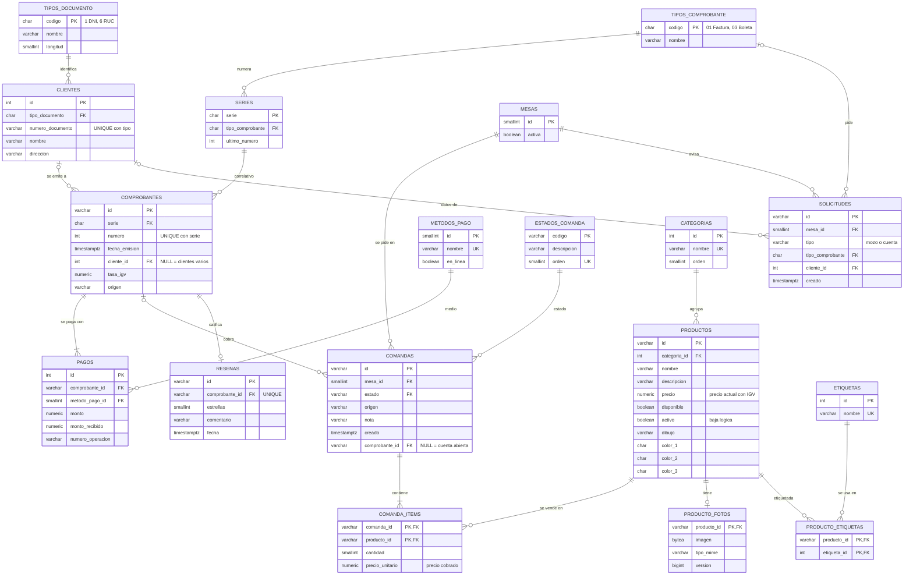

# Base de datos — La Brasa Restobar (PostgreSQL / Supabase, 3FN)

**18 tablas** en Tercera Forma Normal, **4 vistas** que calculan los importes, y seguridad para Supabase (RLS activo y sin acceso público por la API).

| Archivo | Para qué |
|---|---|
| `server/schema.sql` | Crea catálogos, tablas, índices, vistas y seguridad. Se puede ejecutar varias veces. |
| `server/datos_iniciales.sql` | Mesas, categorías, carta y etiquetas (generado desde `src/data.js` con `node scripts/generar-datos-iniciales.mjs`). |

**Instalación:** el servidor ejecuta ambos al arrancar con `DATABASE_URL`. También puedes pegarlos en Supabase → **SQL Editor** → **Run** (primero `schema.sql`, luego `datos_iniciales.sql`).

---

## 1. Diagrama entidad-relación


*(GitHub y VS Code muestran este diagrama; también puedes pegarlo en https://mermaid.live)*

**Cómo se lee el flujo:** una **mesa** genera **comandas** con sus **ítems**. Al cobrar, se crea un **comprobante** (con su **serie**, el **cliente** si dio DNI o RUC, y su **pago**), y todas las comandas abiertas de esa mesa apuntan a él. El detalle y los totales del comprobante se **calculan** a partir de esas comandas.

---

## 2. Diccionario de datos

| Tabla | Clave primaria | Descripción | Claves foráneas |
|---|---|---|---|
| `tipos_documento` | `codigo` | Catálogo 06 SUNAT: DNI (1), RUC (6) | — |
| `tipos_comprobante` | `codigo` | Catálogo 01 SUNAT: Factura (01), Boleta (03) | — |
| `metodos_pago` | `id` | Efectivo, Tarjeta, Yape, Plin | — |
| `estados_comanda` | `codigo` | nuevo → preparando → listo → entregado | — |
| `mesas` | `id` | Número de mesa | — |
| `categorias` | `id` | Hamburguesas, Salchipapas, … | — |
| `productos` | `id` | Carta: nombre, precio actual, disponible, activo | `categoria_id` |
| `producto_fotos` | `producto_id` | Foto real (1 a 1) | `producto_id` |
| `etiquetas` | `id` | Palabras clave del bot | — |
| `producto_etiquetas` | (`producto_id`, `etiqueta_id`) | Relación muchos a muchos | ambas |
| `clientes` | `id` (único: tipo + número de documento) | Nombre o razón social, dirección | `tipo_documento` |
| `series` | `serie` | B001 / F001 y su último número | `tipo_comprobante` |
| `comprobantes` | `id` (único: serie + número) | Fecha, tasa de IGV, origen (caja/qr) | `serie`, `cliente_id` |
| `pagos` | `id` | Monto, monto recibido, n.° de operación | `comprobante_id`, `metodo_pago_id` |
| `comandas` | `id` | Pedido enviado a cocina | `mesa_id`, `estado`, `comprobante_id` |
| `comanda_items` | (`comanda_id`, `producto_id`) | Cantidad y precio cobrado | ambas |
| `solicitudes` | `id` (único: mesa + tipo) | "Llama al mozo" / "pide la cuenta" | `mesa_id`, `tipo_comprobante`, `cliente_id` |
| `resenas` | `id` (único: comprobante) | Estrellas y comentario | `comprobante_id` |

Además, cada tabla tiene restricciones `CHECK`: precios mayores a 0, estrellas de 1 a 5, cantidad de 1 a 50, monto recibido mayor o igual al monto, y tipo MIME de la foto.

---

## 3. Normalización paso a paso

### Diseño anterior (no normalizado)
```
productos(id, categoria, nombre, precio, arte{JSON}, tags[JSON], foto, ...)
comprobantes(id, tipo, serie, numero, mesa, cliente_tipo_doc, cliente_doc, cliente_nombre,
             cliente_direccion, gravada, igv, total, letras, pago_metodo, pago_recibido, pago_vuelto, ...)
comprobante_items(id, comprobante_id, producto_id, nombre, precio, cantidad)
comanda_items(id, comanda_id, producto_id, nombre, precio, cantidad)
solicitudes(id, mesa, tipo, datos{JSON})
resenas(id, mesa, estrellas, comentario, comprobante_id, fecha)
correlativos(serie, ultimo)
```

### 1FN — valores atómicos, sin grupos repetidos
| Problema | Solución |
|---|---|
| `productos.tags` guardaba una lista JSON (varios valores en una celda) | Tablas `etiquetas` y `producto_etiquetas` (muchos a muchos) |
| `productos.arte` era un objeto JSON | Columnas atómicas `dibujo`, `color_1`, `color_2`, `color_3` |
| `solicitudes.datos` era un JSON con tipo, documento, nombre y dirección | `tipo_comprobante` (FK) y `cliente_id` (FK a `clientes`) |

### 2FN — sin dependencias parciales de una clave compuesta
| Problema | Solución |
|---|---|
| En `comanda_items`, `nombre` dependía solo de `producto_id` (parte de la clave), no del ítem completo | Se quitó `nombre`; se obtiene con un JOIN a `productos` |
| `comprobante_items` repetía los productos que ya estaban en las comandas | Se eliminó la tabla: el detalle se calcula en la vista `v_comprobante_detalle` |

### 3FN — sin dependencias transitivas (un atributo no clave que depende de otro atributo no clave)
| Dependencia transitiva | Solución |
|---|---|
| `comprobante → cliente_doc → cliente_nombre, cliente_direccion` | Tabla `clientes`; el comprobante guarda solo `cliente_id` |
| `comprobante → serie → tipo` (B001 siempre es boleta) | `series(serie, tipo_comprobante)`; el comprobante solo guarda `serie` |
| `comprobante → pago_metodo, pago_recibido…` (el pago es otra entidad) | Tabla `pagos` + catálogo `metodos_pago` |
| `gravada`, `igv`, `total`, `letras` dependían del detalle, no de la clave | No se guardan: los calculan las vistas (o la app) |
| `pago_vuelto = recibido − total` | No se guarda: `monto_recibido − monto` |
| `resenas.mesa` dependía del comprobante | Se quitó; la mesa sale del comprobante → comandas |
| `comprobantes.mesa` dependía de las comandas cobradas | Se quitó; `comandas.comprobante_id` relaciona ambas |
| `comanda.estado = 'pagado'` dependía de si tenía comprobante | "Pagado" significa `comprobante_id IS NOT NULL`; se quitó ese estado |
| `productos.categoria` (texto repetido en cada producto) | Tabla `categorias` + `categoria_id` |
| Valores de estado y tipo de documento escritos a mano en cada fila | Catálogos `estados_comanda`, `tipos_documento`, `tipos_comprobante` |

---

## 4. Decisiones de diseño (para defenderlas en la exposición)

1. **`comanda_items.precio_unitario` no es redundante.** Es el precio cobrado en ese momento, un hecho de la venta. `productos.precio` es el precio actual y puede cambiar. Comprobado: si la hamburguesa sube de S/ 14 a S/ 15 después de pedirla, el comprobante sigue cobrando S/ 14.
2. **`comprobantes.tasa_igv` se guarda** porque es la tasa vigente al emitir, y la ley puede cambiarla después.
3. **`pagos.monto` se guarda** aunque hoy coincide con el total, porque un comprobante podría pagarse con dos medios (parte en efectivo y parte con Yape).
4. **Baja lógica de productos (`activo = FALSE`)**. Un producto ya vendido no se borra, para que el historial siga mostrando su nombre.
5. **Foto en una tabla aparte (1 a 1)**, para no leer imágenes pesadas cada vez que se consulta la carta.
6. **Limitación conocida:** el nombre del cliente y el del producto se obtienen por JOIN. Si se editan después, una reimpresión mostrará el dato nuevo. En producción, la copia legal e inmutable es el XML enviado a SUNAT; por eso no se duplican en la base de datos.

---

## 5. Vistas

| Vista | Devuelve |
|---|---|
| `v_comprobante_detalle` | Productos de cada comprobante: descripción, precio unitario, cantidad e importe |
| `v_comprobantes` | Comprobante completo: número `B001-00000001`, tipo, mesa, cliente, op. gravada, IGV y total |
| `v_cierre_caja` | Ventas por día (hora de Lima) y método de pago |
| `v_carta` | Carta activa con categoría, foto (sí/no) y etiquetas |

Consultas de ejemplo (Supabase → SQL Editor):
```sql
-- Comprobantes del día con sus totales
SELECT numero_completo, tipo_nombre, cliente, op_gravada, igv, total
FROM v_comprobantes WHERE fecha_emision::date = current_date ORDER BY numero_completo;

-- Cierre de caja de hoy
SELECT metodo_pago, operaciones, total FROM v_cierre_caja WHERE dia = current_date;

-- Productos más vendidos
SELECT descripcion, SUM(cantidad) AS unidades, SUM(importe) AS vendido
FROM v_comprobante_detalle GROUP BY descripcion ORDER BY unidades DESC LIMIT 10;

-- Calificación promedio
SELECT ROUND(AVG(estrellas), 1) AS promedio, COUNT(*) AS resenas FROM resenas;
```

---

## 6. Seguridad (Supabase)
- **RLS activo** en las 18 tablas, sin políticas: la API pública de Supabase no puede leer ni escribir nada.
- Se revocan los permisos de `anon` y `authenticated` en tablas y vistas; las vistas usan `security_invoker`.
- La app se conecta como dueña de las tablas (cadena *Session pooler*), así que no la afecta RLS.
